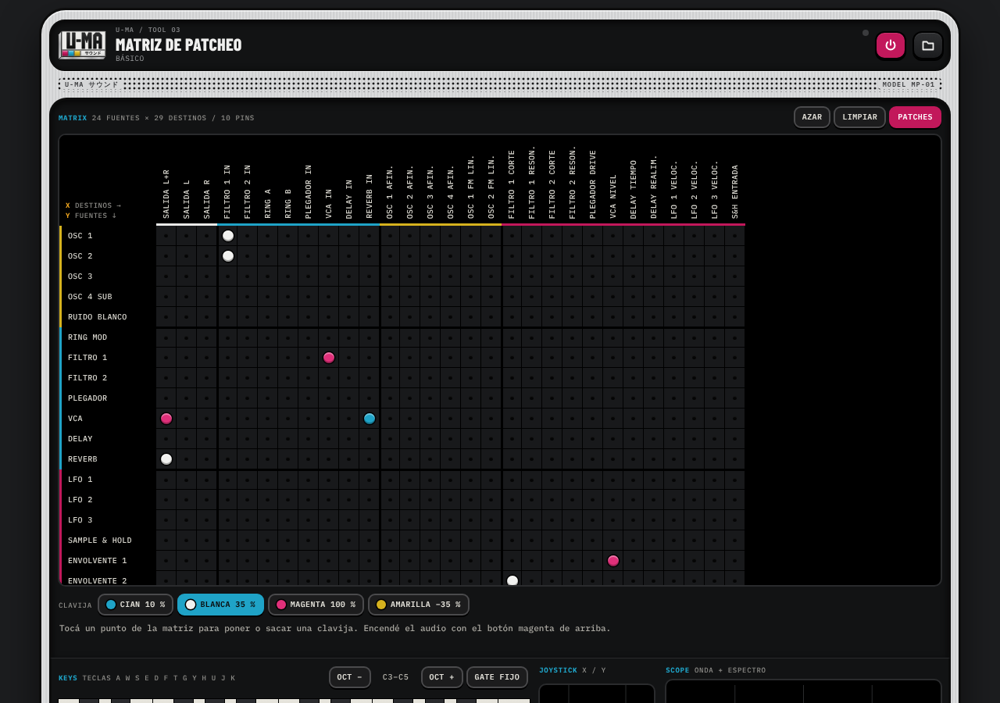

# Matriz de patcheo / U-MA

Sintetizador modular que corre en el navegador. Se arma el sonido poniendo clavijas en una matriz, al estilo del **EMS Synthi**: cada fila es una fuente (osciladores, filtros, LFO, envolventes…) y cada columna un destino (salidas, entradas de audio y parámetros).

**Abrir la app → https://buenosairesfront.github.io/matrizdepatcheo/**

Es parte de las herramientas de **Buenos Aires Front** (U-MA / Tool 03).



## Qué trae

- **Matriz de 24 fuentes × 29 destinos** con cuatro clavijas de distinta intensidad (cian 10 %, blanca 35 %, magenta 100 %, amarilla −35 %).
- **4 osciladores, ruido blanco, ring mod, 2 filtros, plegador de onda, VCA, delay y reverb.**
- **3 LFO, sample & hold, 2 envolventes ADSR**, teclado, gate, joystick X/Y, rueda y una continua +1.
- **Teclado** en pantalla y con la compu (teclas `A W S E D F T G Y H U J K`), con glide y gate fijo.
- **Arpegiador** en escala: 8 escalas (incluye Hirajoshi e In sen), patrón acorde o escala, 4 recorridos, divisiones hasta 1/16 y tempo de 40 a 240 bpm.
- **Osciloscopio** con onda y espectro.
- **Controles visuales:** faders, botones con la silueta de cada onda y filtro, y una pantalla por módulo con su forma en vivo. Tocando una fuente en la matriz se abren sus controles ahí mismo.
- **12 patches clásicos de fábrica** y biblioteca propia: guardar en el navegador, copiar como código o exportar e importar archivos `.json`.
- Limitador a la salida, tema claro y oscuro, funciona en celular.

No necesita instalación, servidor ni dependencias: es un único archivo `index.html` que usa Web Audio.

## Uso rápido

1. Abrí la app y tocá el botón magenta de arriba (⏻) para encender el audio.
2. Arranca con el patch **Básico**: tocá el teclado y ya suena.
3. Elegí una clavija abajo de la matriz y tocá un punto para conectar. Tocá de nuevo con la misma clavija para sacarla.
4. En **Patches** cargás los clásicos, guardás los tuyos y exportás archivos.

El manual completo está en [`docs/MANUAL.md`](docs/MANUAL.md).

## Documentación

| Archivo | Contenido |
| --- | --- |
| [`docs/MANUAL.md`](docs/MANUAL.md) | Manual de uso: módulos, fuentes, destinos, clavijas, arpegiador, patches de fábrica y recetas. |
| [`docs/FORMATO-PATCH.md`](docs/FORMATO-PATCH.md) | Formato de los archivos `.json` de patch y de biblioteca, con todos los identificadores. |
| [`docs/LANDING.md`](docs/LANDING.md) | Cómo enlazar esta herramienta desde la landing de Buenos Aires Front. |
| [`docs/PUBLICAR.md`](docs/PUBLICAR.md) | Cómo está publicada (GitHub Pages), cómo correrla local y cómo actualizarla. |
| [`ejemplos/`](ejemplos/) | Los 12 patches de fábrica como archivos `.json` listos para importar. |

## Estructura del repo

```
index.html          la app completa (HTML + CSS + JS en un solo archivo)
favicon.svg         ícono
landing.json        datos de la tarjeta para la landing de Buenos Aires Front
.nojekyll           le dice a GitHub Pages que sirva los archivos tal cual
docs/               manual, formato de patch, landing, publicación y capturas
ejemplos/           patches de fábrica en .json
```

## Correr local

Abrí `index.html` con doble clic, o levantá un servidor estático:

```sh
python3 -m http.server 8000
# y abrí http://localhost:8000
```

## Compatibilidad

Chrome, Edge, Firefox y Safari actuales, en escritorio y en celular (iOS y Android). En iPhone, si no se oye, revisá que el interruptor de silencio esté apagado.

> **Cuidado con el volumen.** Los lazos de realimentación pueden subir mucho. La salida tiene limitador, pero bajá el volumen si usás auriculares.
